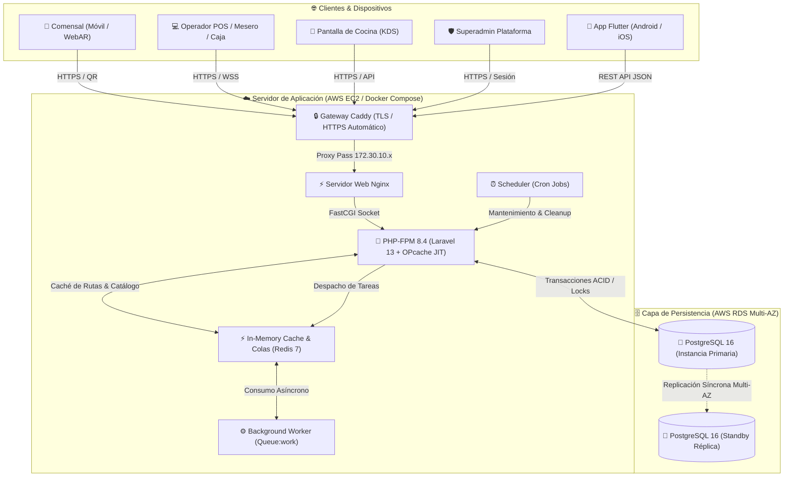

# 🍽️ Adbana SaaS — Restaurant Management Platform

<p align="center">
  
  
  
  
  
  
  
  
</p>

<p align="center">
  <b>Plataforma Cloud Multi-Inquilino (Multi-Tenant) para Restaurantes</b><br>
  Punto de Venta (POS) • Carta Pública Digital con WebAR / 3D • KDS Cocina • Control de Mesas por QR • Inventario & Kardex • Control de Caja y Arqueo • Panel Superadmin
</p>

---

## 📋 Tabla de Contenidos

- [Visión General](#-visión-general)
- [Arquitectura del Sistema](#-arquitectura-del-sistema)
- [Módulos Principales](#-módulos-principales)
- [Experiencia 3D y Realidad Aumentada (AR)](#-experiencia-3d-y-realidad-aumentada-ar)
- [Rendimiento y Pruebas de Estrés en AWS](#-rendimiento-y-pruebas-de-estrés-en-aws)
- [Tecnologías y Stack](#-tecnologías-y-stack)
- [Puesta en Marcha (Instalación Local)](#-puesta-en-marcha-instalación-local)
- [Despliegue en la Nube (AWS)](#-despliegue-en-la-nube-aws)
- [Suite de Pruebas y Calidad de Código](#-suite-de-pruebas-y-calidad-de-código)
- [Estructura del Proyecto](#-estructura-del-proyecto)
- [Seguridad y Resiliencia](#-seguridad-y-resiliencia)
- [Documentación Adicional](#-documentación-adicional)

---

## 🌟 Visión General

**Adbana SaaS** es un sistema web multi-restaurante de grado empresarial diseñado para resolver de punta a punta la operación gastronómica moderna. Con una arquitectura desacoplada y contenedorizada, permite a múltiples restaurantes operar con aislamiento estricto de datos, integrando desde la interacción del comensal en mesa hasta la conciliación contable de caja y el monitoreo de infraestructura en la nube.

### Puntos Fuertes:
* **Aislamiento Multi-Tenant Estricto:** Cada consulta y operación está encapsulada por el contexto del restaurante (`BelongsToRestaurante`), imposibilitando fugas de información entre inquilinos.
* **Tolerancia a Concurrencia Extrema:** Bloqueos pesimistas a nivel de fila (`SELECT ... FOR UPDATE`), transacciones ACID e idempotencia basada en claves UUID y huellas SHA-256 para evitar sobreventa o duplicación de pedidos.
* **Alta Disponibilidad Cloud en AWS:** Desplegado sobre Amazon EC2 y AWS RDS PostgreSQL Multi-AZ con caché distribuido en Redis, compresión OPcache JIT y proxies inversos TLS de alto rendimiento.
* **Experiencia Inmersiva WebAR:** Los comensales pueden inspeccionar platos en 3D e interactuar en Realidad Aumentada en su mesa desde cualquier teléfono inteligente (iOS y Android), sin obligar a descargar aplicaciones.
* **App Móvil Complementaria en Flutter:** Aplicación nativa con visualización de modelos 3D y seguimiento de estados de comanda.

---

## 🏗️ Arquitectura del Sistema

El ecosistema opera mediante micro-servicios contenedorizados y orquestados para máxima resiliencia:



---

## 📦 Módulos Principales

### 1. 📱 Carta Digital Pública & Auto-Pedido
* Acceso instantáneo mediante escaneo de código QR específico por mesa (`/c/{slug}?mesa={id}`).
* Catálogo dinámico por categorías, con fotos en alta resolución, descripciones e indicadores de alérgenos.
* Envío de pedidos a cocina con validación instantánea de stock y cálculo de totales en centavos exactos en el servidor.
* Protección contra desconexiones o doble click accidental gracias a la capa de **idempotencia** (`X-Adbana-Cliente` + UUID).

### 2. 💻 Punto de Venta (POS) & Servicio de Mesas
* Mapa interactivo de mesas con codificación de colores según el estado: *Disponible*, *Ocupada*, *En preparación* o *Por cobrar*.
* Cuentas compartidas o individuales por mesa, soporte para modalidades en mesa, para llevar (*take-out*) y delivery.
* Cobros combinados: Efectivo con cálculo de vuelto en servidor, transferencias digitales (Yape, Plin) y tarjetas bancarias.

### 3. 🍳 Pantalla de Cocina (KDS - Kitchen Display System)
* Recepción de comandas en tiempo real con temporizador de espera por pedido.
* Gestión de ciclo de vida del plato: `Pendiente` ➔ `Confirmado` ➔ `En Preparación` ➔ `Listo` ➔ `Entregado`.
* Reintegro automático de inventario al sistema en caso de cancelación justificada.

### 4. 📦 Control de Inventario & Kardex
* Descuento automático de existencias por plato o por insumos de receta al confirmar cada orden.
* Registro inmutable de movimientos (`movimientos_stock`): compras, mermas, ajustes y ventas.
* Bloqueo estricto contra saldo negativo (`SELECT ... FOR UPDATE` a nivel de base de datos).

### 5. 💰 Gestión de Caja y Turnos
* Apertura de turno con fondo inicial y asignación nominal por operador.
* Registro clasificado de ingresos y egresos de efectivo con motivo y comprobante.
* Cierre ciego de caja con cálculo de descuadre (faltante/sobrante) y arqueo auditado.

### 6. 🛡️ Panel de Administración SaaS (`/administracion`)
* Módulo independiente para operadores de la plataforma con credenciales y sesiones separadas.
* Dashboard con métricas globales: volumen de ventas, número de pedidos, restaurantes activos y altas.
* Gestión de inquilinos, suspensión preventiva, activación y bitácora de auditoría global.

---

## 🕶️ Experiencia 3D y Realidad Aumentada (AR)

Adbana integra tecnologías inmersivas de vanguardia tanto en el navegador web como en su aplicación móvil:

* **WebAR Universal (Cero Instalación):**
  * Utiliza `<model-viewer>` de Google con soporte progresivo para **WebXR**, **Google Scene Viewer** en Android y **Apple Quick Look (.usdz)** en iOS.
  * Los comensales pueden proyectar el plato en escala 1:1 sobre su propia mesa para apreciar el tamaño real de la porción y su presentación.
* **Aplicación Móvil Flutter (`/flutter`):**
  * Diseñada con `dish_model_page.dart` para una interacción táctil fluida (rotación 360°, zoom y texturas PBR).
  * Consumo directo de la API REST de Adbana con sincronización de estado de pedidos.

---

## ⚡ Rendimiento y Pruebas de Estrés en AWS

El sistema fue sometido a ensayos de estrés rigurosos con **Grafana k6** atacando la ruta más pesada y crítica del sistema: **`POST /api/carta/{slug}/pedidos`** (escritura en base de datos, transacción ACID, bloqueo pesimista de filas y actualización de stock).

### 📊 Benchmark en AWS EC2 (`t3.micro`) + RDS PostgreSQL Multi-AZ
Prueba de concurrencia masiva con **550 usuarios virtuales (VUs)** ejecutando transacciones continuas durante **1 minuto**:

| Métrica de Rendimiento | Antes de la Optimización | Después de la Optimización | Factor de Mejora |
| :--- | :---: | :---: | :---: |
| **Pedidos Registrados en BD (HTTP 201)** | `2,475 pedidos` | **`5,822 pedidos`** | **+135.2% (~2.35x)** |
| **Throughput de Transacciones** | `29.56 pedidos / s` | **`73.18 pedidos / s`** | **+147.6% (~2.48x)** |
| **Peticiones HTTP Procesadas** | `30.19 req / s` | **`73.85 req / s`** | **+144.6%** |
| **Latencia Promedio (`avg`)** | `597.81 ms` | **`266.42 ms`** | **-55.4% (Más del doble de rápido)** |
| **Latencia Mediana (`med`)** | `582.17 ms` | **`248.25 ms`** | **-57.4%** |
| **Latencia Percentil 90 (`p90`)** | `710.92 ms` | **`306.56 ms`** | **-56.9%** |
| **Latencia Percentil 95 (`p95`)** | `777.90 ms` | **`344.43 ms`** | **-55.7%** |
| **Latencia Máxima (`max`)** | `6.99 s` | **`1.74 s`** | **-75.1%** |
| **Tasa de Error HTTP (`http_req_failed`)** | **0.00%** (`0 / 2,528`) | **`0.00%` (`0 / 5,875`)** | **100% Estable** |
| **Uso de Memoria RAM (`app`)** | ~180 MiB | **114.3 MiB (12.5% de RAM)** | **Optimizado para t3.micro** |

> **Clave de la Optimización:**  
> Se redujeron los round-trips a RDS de 14 a 10 consultas por pedido mediante caché en Redis (`restaurante_pedido:$slug`), inserciones por lotes (*bulk inserts*), hidratación en memoria de relaciones, compilación OPcache con Tracing JIT y pool de conexiones persistentes a PostgreSQL y Redis.

---

## 🛠️ Tecnologías y Stack

| Capa | Tecnologías |
| :--- | :--- |
| **Backend** | PHP 8.4 (FPM), Laravel 13, Eloquent ORM, Laravel Sanctum |
| **Base de Datos** | PostgreSQL 16 (Índices B-Tree compuestos, Transacciones Serializable/Read Committed) |
| **Caché y Colas** | Redis 7 Alpine (In-Memory Key-Value, Queue Driver, Rate Limiting) |
| **Servidores Web / Proxy** | Caddy 2 (TLS / HTTP/2 / HTTP/3), Nginx 1.31 Alpine (Reverse Proxy & FastCGI) |
| **Contenedores & Cloud** | Docker, Docker Compose, AWS EC2, AWS RDS Multi-AZ, AWS CloudWatch |
| **Frontend Web** | Blade Templates, Tailwind CSS, Alpine.js, WebXR, Google Model-Viewer |
| **Aplicación Móvil** | Flutter 3.x, Dart, model_viewer_plus, HTTP client |
| **Testing & Benchmark** | PHPUnit 12.5, Grafana k6, Node.js Test Suite |

---

## 🚀 Puesta en Marcha (Instalación Local)

### Prerrequisitos
* [Docker Desktop](https://www.docker.com/products/docker-desktop/) (Motor Linux con WSL2 habilitado en Windows).
* Git instalado.

### Opción 1: Inicio Rápido en Windows (1 Solo Clic)
El proyecto incluye un lanzador optimizado que almacena `vendor` en un volumen de Docker para evitar la sobrecarga del sistema de archivos de Windows:

```cmd
git clone https://github.com/tu-usuario/adbana.git
cd adbana
copy .env.example .env
copy src\.env.example src\.env
.\iniciar-rapido.cmd
```

### Opción 2: Instalación Estándar con Docker Compose
1. **Configurar los archivos de entorno:**
   ```bash
   cp .env.example .env
   cp src/.env.example src/.env
   ```
   *(Asegúrate de que `DB_PASSWORD` coincida en ambos archivos).*

2. **Construir y levantar los contenedores:**
   ```bash
   docker compose up -d --build
   ```

3. **Instalar dependencias y ejecutar migraciones:**
   ```bash
   docker compose exec app composer install
   docker compose exec app php artisan key:generate
   docker compose exec app php artisan migrate
   ```

4. **Acceder a los módulos locales:**
   * 🖥️ **Panel del Restaurante:** [http://localhost:8080/panel](http://localhost:8080/panel)
   * 📱 **Carta Pública:** `http://localhost:8080/c/{slug-del-restaurante}`
   * 🛡️ **Superadmin de Plataforma:** [http://localhost:8080/administracion](http://localhost:8080/administracion)
   * 🗄️ **Adminer (Gestor BD):** [http://localhost:8085](http://localhost:8085) *(Servidor: `db`, Usuario: `adbana`)*

5. **Crear el primer Superadministrador (CLI):**
   ```bash
   docker compose exec app php artisan adbana:crear-superadmin
   ```

---

## ☁️ Despliegue en la Nube (AWS)

El proyecto cuenta con un stack de producción nativo para AWS (`compose.aws.yml`):

1. **Configurar las credenciales de producción:**
   ```bash
   cp .env.production.example .env.production
   ```
   Configura el host de AWS RDS (`DB_HOST`), credenciales maestras y dominio del gateway (`APP_DOMAIN`).

2. **Construir y desplegar la pila de servicios:**
   ```bash
   docker compose -f compose.aws.yml build app web
   docker compose -f compose.aws.yml up -d
   ```

3. **Ejecutar migraciones en el contenedor de aplicación:**
   ```bash
   docker compose -f compose.aws.yml exec app php artisan migrate --force
   ```

4. **Monitoreo y pruebas de carga integradas:**
   * **Monitoreo en vivo de RDS:** `.\ver-base-datos.cmd`
   * **Prueba de carga masiva k6:** `.\probar-estres-aws.cmd 50000 550 1m`
   * **Prueba de estrés por tiempo:** `.\probar-estres-tiempo.cmd 1m 550 tiempo`

---

## 🧪 Suite de Pruebas y Calidad de Código

### Pruebas Unitarias y de Integración (PHPUnit)
El sistema incluye una suite con más de **100 pruebas automatizadas y 594 aserciones**:

```bash
# Crear base de pruebas dedicada (solo la primera vez)
docker compose exec db psql -U adbana -d postgres -c "CREATE DATABASE adbana_test;"

# Ejecutar la suite completa
docker compose exec app php artisan test
```

### Pruebas de Regresión Frontend
```bash
node src/tests/Frontend/panel-carta.cjs
node src/tests/Frontend/robustez.cjs
```

---

## 📂 Estructura del Proyecto

```text
Adbana_saasReal/
├── .agents/                 # Habilidades y agentes de optimización AR y backend
├── deploy/                  # Configuraciones de despliegue cloud (Caddy, Nginx, PHP-FPM, OPcache)
│   ├── Caddyfile            # Proxy inverso TLS / HTTP3
│   ├── entrypoint.sh        # Script de inicialización y optimización de cachés
│   ├── php-fpm-production.conf # Tuning de procesos PHP-FPM
│   └── php-production.ini   # Configuración de memoria y JIT
├── flutter/                 # Aplicación móvil nativa Adbana Carta
│   ├── lib/                 # Código Dart (Modelos, Vistas AR, Carrito, Seguimiento)
│   └── pubspec.yaml         # Dependencias Flutter
├── k6/                      # Scripts de benchmarking y estrés masivo
│   ├── carga.js             # Escenario de lectura de menú
│   └── estres-masivo.js     # Escenario de concurrencia y escritura en BD
├── src/                     # Núcleo de la aplicación Laravel 13
│   ├── app/                 # Modelos, Controladores, Middlewares y Lógica de Negocio
│   ├── config/              # Configuraciones de base de datos, caché y auth
│   ├── database/            # Migraciones y Seeders relacionales
│   ├── docs/                # Documentación técnica extendida del proyecto
│   ├── resources/views/     # Vistas Blade (Panel, Carta, Mesas, Cocina, Superadmin)
│   └── routes/              # Definición de rutas Web y API REST
├── tools/                   # Binarios locales independientes (k6 standalone)
├── compose.aws.yml          # Orquestación de contenedores para producción AWS
├── docker-compose.yml       # Orquestación para entorno de desarrollo local
├── iniciar-rapido.cmd       # Automatización de inicio en 1 clic para Windows
├── probar-estres-aws.cmd    # Lanzador de pruebas de estrés contra AWS
└── README.md                # Documentación principal
```

---

## 🔒 Seguridad y Resiliencia

* **Cifrado de Credenciales:** Hashing criptográfico con algoritmo **Bcrypt** (`BCRYPT_ROUNDS=12`).
* **Protección Anti-Duplicados (Idempotencia):** Huellas hash SHA-256 combinadas con identificadores UUID de transacción para asegurar que peticiones repetidas por inestabilidad de red no cobren ni descuenten stock dos veces.
* **Rate Limiting Inteligente:** Limitadores dinámicos por IP, ruta y usuario (`throttle:login`, `throttle:pedidos-publicos`), mitigando ataques de fuerza bruta y denegación de servicio (DoS).
* **Auditoría de Acciones Críticas:** Traza histórica de modificaciones mediante el trait `Auditable`, registrando operador, fecha, IP y atributos modificados (con censura automática de contraseñas y tokens).
* **Cookies de Sesión Endurecidas:** Banderas `HttpOnly`, `SameSite=Lax` y `Secure` habilitadas en entornos de producción.

---

## 📚 Documentación Adicional

Para profundizar en el diseño y los detalles de arquitectura, consulta la documentación en `src/docs/`:

* 📖 [Documentación Técnica Integral (25% - Semana 9)](src/docs/DOCUMENTACION-PROYECTO-25.md)
* 📊 [Diagrama de Base de Datos y Entidad-Relación](src/docs/DIAGRAMA-BD.md)
* 🔐 [Matriz de Roles y Permisos Granulares](src/docs/PERMISOS.md)
* 🛡️ [Políticas de Consistencia y Escalabilidad](src/docs/CONSISTENCIA-Y-ESCALABILIDAD.md)
* 💻 [Especificación del Punto de Venta (POS)](src/docs/POS.md)
* 📱 [Guía del Módulo de Realidad Aumentada (AR)](src/public/demo-ar/README.md)

---

<p align="center">
  <b>Adbana SaaS</b> • Desarrollado con excelencia para la transformación digital gastronómica.
</p>
