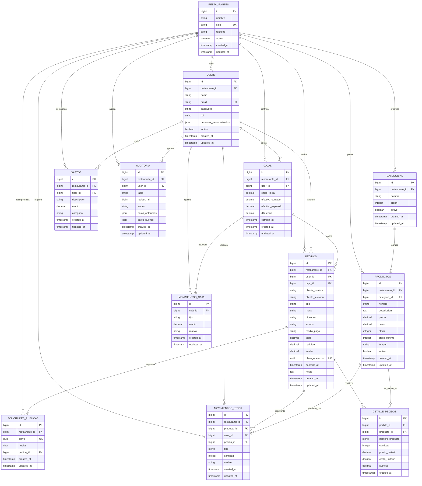

# Diagrama de Base de Datos - Adbana SaaS (Entregable 25%)

Este documento contiene el modelo entidad-relación (ER) de la base de datos PostgreSQL de Adbana SaaS en formato **editable** (Mermaid y DBML).

---

## 1. Diagrama Entidad-Relación (Editable con Mermaid)

> Puedes editar este bloque directamente en Markdown, o copiarlo y pegarlo en [Mermaid Live Editor](https://mermaid.live).



---

## 2. Formato DBML (Database Markup Language)

> Puedes copiar este código en [dbdocs.io](https://dbdocs.io) o [dbdiagram.io](https://dbdiagram.io) para generar y exportar diagramas en PDF, PNG o SVG interactivos.

```dbml
Table restaurantes {
  id bigint [pk, increment]
  nombre varchar
  slug varchar [unique]
  telefono varchar
  activo boolean [default: true]
  created_at timestamp
  updated_at timestamp
}

Table users {
  id bigint [pk, increment]
  restaurante_id bigint [ref: > restaurantes.id]
  name varchar
  email varchar [unique]
  password varchar
  rol varchar [default: 'cajero']
  permisos_personalizados json
  activo boolean [default: true]
  created_at timestamp
  updated_at timestamp
}

Table categorias {
  id bigint [pk, increment]
  restaurante_id bigint [ref: > restaurantes.id]
  nombre varchar
  orden int [default: 0]
  activo boolean [default: true]
  created_at timestamp
  updated_at timestamp
}

Table productos {
  id bigint [pk, increment]
  restaurante_id bigint [ref: > restaurantes.id]
  categoria_id bigint [ref: > categorias.id]
  nombre varchar
  descripcion text
  precio decimal(10,2)
  costo decimal(10,2) [default: 0]
  stock int [default: 0]
  stock_minimo int [default: 0]
  imagen varchar
  activo boolean [default: true]
  created_at timestamp
  updated_at timestamp
}

Table pedidos {
  id bigint [pk, increment]
  restaurante_id bigint [ref: > restaurantes.id]
  user_id bigint [ref: > users.id]
  caja_id bigint [ref: > cajas.id]
  cliente_nombre varchar
  cliente_telefono varchar
  tipo varchar
  mesa varchar
  direccion varchar
  estado varchar
  medio_pago varchar
  total decimal(10,2)
  recibido decimal(12,2)
  vuelto decimal(12,2)
  clave_operacion uuid
  cobrado_at timestamp
  notas text
  created_at timestamp
  updated_at timestamp
}

Table detalle_pedidos {
  id bigint [pk, increment]
  pedido_id bigint [ref: > pedidos.id]
  producto_id bigint [ref: > productos.id]
  nombre_producto varchar
  cantidad int
  precio_unitario decimal(10,2)
  costo_unitario decimal(10,2)
  subtotal decimal(10,2)
  created_at timestamp
}

Table cajas {
  id bigint [pk, increment]
  restaurante_id bigint [ref: > restaurantes.id]
  user_id bigint [ref: > users.id]
  saldo_inicial decimal(12,2)
  efectivo_contado decimal(12,2)
  efectivo_esperado decimal(12,2)
  diferencia decimal(12,2)
  cerrada_at timestamp
  created_at timestamp
  updated_at timestamp
}

Table movimientos_caja {
  id bigint [pk, increment]
  caja_id bigint [ref: > cajas.id]
  tipo varchar(10)
  monto decimal(12,2)
  motivo varchar
  created_at timestamp
  updated_at timestamp
}

Table movimientos_stock {
  id bigint [pk, increment]
  restaurante_id bigint [ref: > restaurantes.id]
  producto_id bigint [ref: > productos.id]
  user_id bigint [ref: > users.id]
  pedido_id bigint [ref: > pedidos.id]
  tipo varchar(20)
  cantidad int
  motivo varchar
  created_at timestamp
  updated_at timestamp
}

Table gastos {
  id bigint [pk, increment]
  restaurante_id bigint [ref: > restaurantes.id]
  user_id bigint [ref: > users.id]
  descripcion varchar
  monto decimal(10,2)
  categoria varchar
  created_at timestamp
  updated_at timestamp
}

Table auditoria {
  id bigint [pk, increment]
  restaurante_id bigint [ref: > restaurantes.id]
  user_id bigint [ref: > users.id]
  tabla varchar
  registro_id bigint
  accion varchar
  datos_anteriores json
  datos_nuevos json
  created_at timestamp
  updated_at timestamp
}

Table solicitudes_publicas {
  id bigint [pk, increment]
  restaurante_id bigint [ref: > restaurantes.id]
  clave uuid
  huella char(64)
  pedido_id bigint [ref: > pedidos.id]
  created_at timestamp
  updated_at timestamp
}
```
