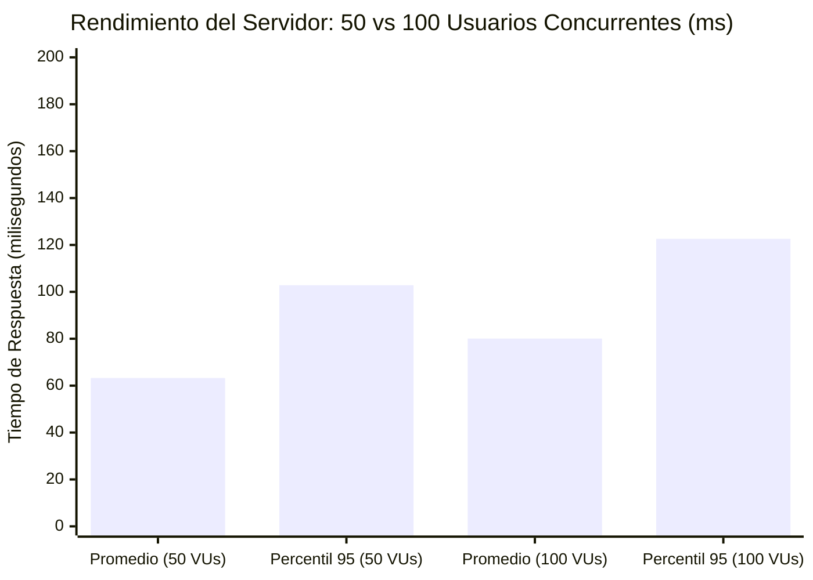
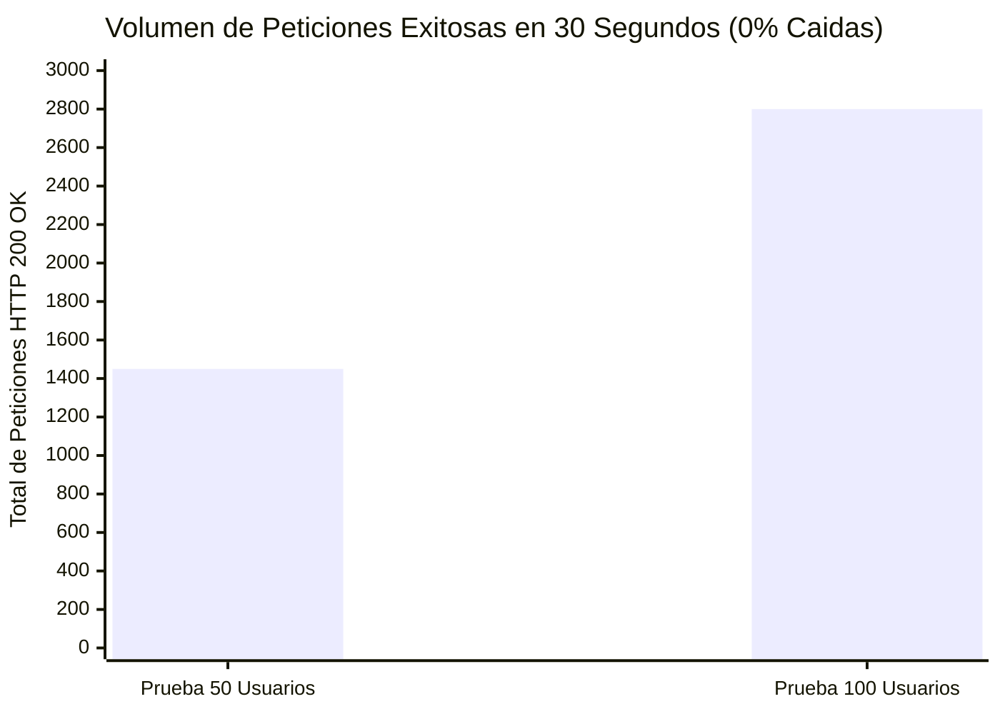
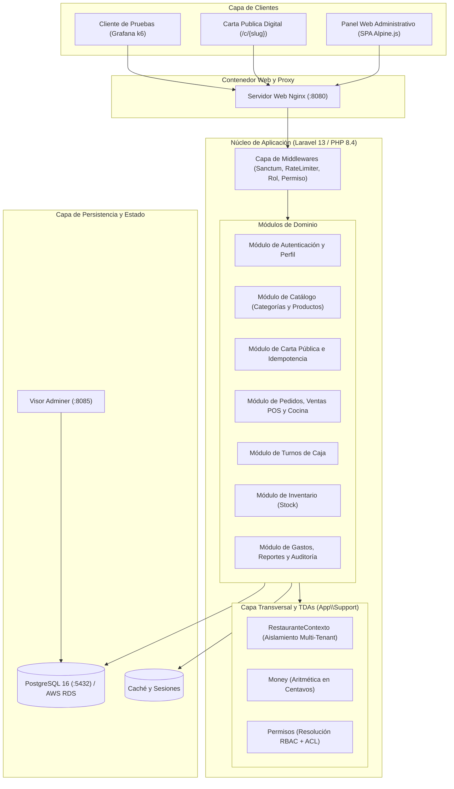
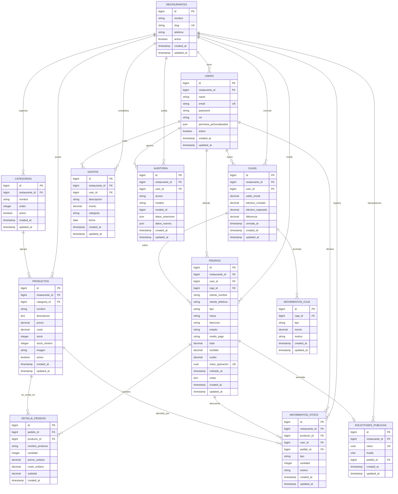
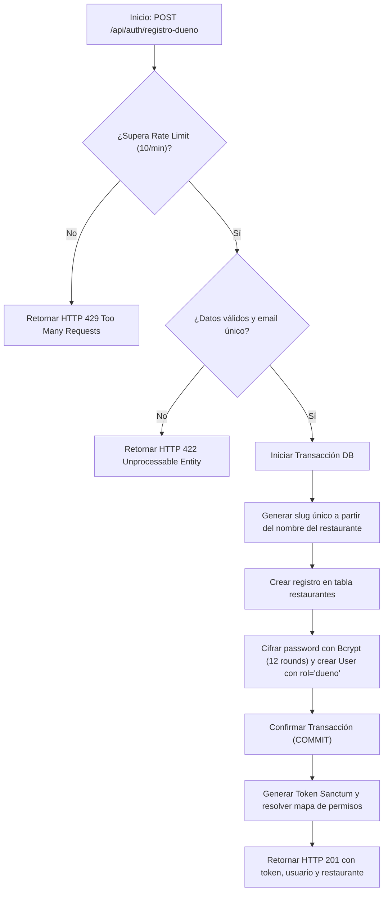
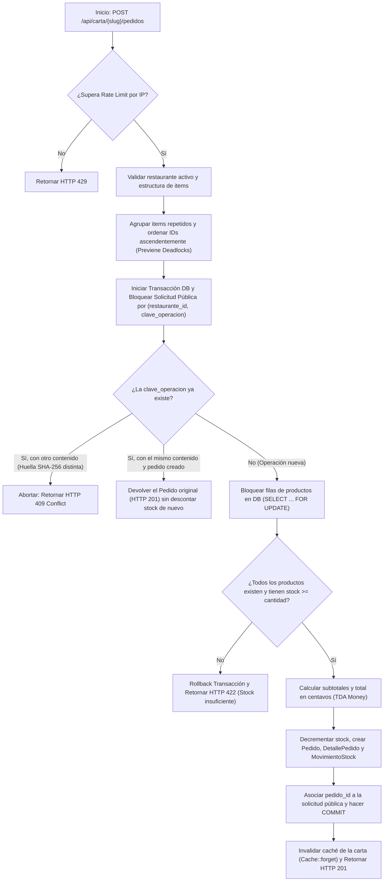

# Documentación Técnica del Proyecto de Software: Adbana SaaS (Entregable 25%)

**Proyecto:** Adbana SaaS — Sistema Web Multi-Restaurante (POS, Pedidos, Carta Pública e Inventario)  
**Fase de Evaluación:** Entregable del 25% (Semana 9)  
**Estándar de Referencia:** Guía para la Documentación de Proyectos de Software  

---

## Índice General

1. [Definiciones y Especificación de Requerimientos](#1-definiciones-y-especificación-de-requerimientos)
   - [1.1. Definición General del Proyecto de Software](#11-definición-general-del-proyecto-de-software)
   - [1.2. Especificación de Requerimientos del Proyecto](#12-especificación-de-requerimientos-del-proyecto)
   - [1.3. Especificaciones de Procedimientos (Desarrollo, Instalación y Prueba)](#13-especificaciones-de-procedimientos-desarrollo-instalación-y-prueba)
2. [Arquitectura del Sistema](#2-arquitectura-del-sistema)
   - [2.1. Descripción Jerárquica](#21-descripción-jerárquica)
   - [2.2. Diagrama de Módulos](#22-diagrama-de-módulos)
   - [2.3. Descripción Individual de los Módulos](#23-descripción-individual-de-los-módulos)
   - [2.4. Dependencias Externas y Decisiones de Diseño Tecnológico](#24-dependencias-externas-y-decisiones-de-diseño-tecnológico)
3. [Diseño del Modelo de Datos](#3-diseño-del-modelo-de-datos)
   - [3.1. Entidades y Relaciones (Formato Language-Agnostic)](#31-entidades-y-relaciones-formato-language-agnostic)
   - [3.2. Diagrama Entidad-Relación (Editable)](#32-diagrama-entidad-relación-editable)
   - [3.3. Clasificación de Datos (Entrada, Internos y Salida)](#33-clasificación-de-datos-entrada-internos-y-salida)
4. [Descripción de Procesos y Servicios Ofrecidos por el Sistema](#4-descripción-de-procesos-y-servicios-ofrecidos-por-el-sistema)
   - [4.1. Registro Transaccional de Restaurante y Dueño](#41-registro-transaccional-de-restaurante-y-dueño)
   - [4.2. Autenticación (Login) y Control de Rate Limiting](#42-autenticación-login-y-control-de-rate-limiting)
   - [4.3. Recepción de Pedidos Públicos con Idempotencia y Control de Stock](#43-recepción-de-pedidos-públicos-con-idempotencia-y-control-de-stock)
   - [4.4. Control Centralizado de Respuestas y Errores HTTP](#44-control-centralizado-de-respuestas-y-errores-http)
5. [Documentación Técnica — Especificación API y TDAs](#5-documentación-técnica--especificación-api-y-tdas)
   - [5.1. Sinopsis de Invocación del Sistema](#51-sinopsis-de-invocación-del-sistema)
   - [5.2. Especificación Detallada de Endpoints REST](#52-especificación-detallada-de-endpoints-rest)
   - [5.3. Tipos de Datos Abstractos (TDAs) y Estructuras Internas](#53-tipos-de-datos-abstractos-tdas-y-estructuras-internas)
6. [Conclusiones](#6-conclusiones)

---

## 1. Definiciones y Especificación de Requerimientos

### 1.1. Definición General del Proyecto de Software

#### Idea General (¿Qué es?)
**Adbana SaaS** es una plataforma web multi-inquilino (*multi-tenant*) diseñada bajo el modelo *Software as a Service* para la gestión operativa, comercial y administrativa de restaurantes. El sistema centraliza en una única arquitectura contenedorizada el catálogo de productos y categorías, la carta pública digital para comensales, la recepción de pedidos en tiempo real, el punto de venta (POS), la vista de comandas para cocina, el control de inventario (stock) y la gestión de turnos de caja.

#### Objetivos (¿Para qué?)
El objetivo principal del desarrollo es digitalizar y asegurar el flujo operativo de pequeños y medianos restaurantes mediante un sistema aislado por negocio que evite errores humanos en el cálculo de cobros, prevenga la sobreventa de productos sin stock ante pedidos concurrentes y garantice el control financiero por turno.
* **Necesidad cubierta:** Elimina la pérdida de comandas, las inconsistencias entre el inventario físico y las ventas, la exposición de costos confidenciales al personal operativo y la vulnerabilidad ante envíos duplicados o saturación de peticiones en la carta pública.

#### Usuarios (¿Quién?)
El sistema e informe están dirigidos a dos grupos de usuarios con distintos niveles de experiencia técnica:
1. **Usuarios Finales Operativos (Experiencia técnica básica):**
   - **Dueño del Restaurante:** Registra el negocio, administra categorías, productos, costos, personal, permisos delegados, gastos, reportes financieros y auditoría.
   - **Cajero / Mozo / Cocina:** Personal operativo que interactúa con el panel web (`http://localhost:8080/panel`) según sus permisos asignados para tomar pedidos, preparar comandas o cobrar en caja.
   - **Comensal (Cliente Público):** Usuario anónimo que consulta la carta pública (`http://localhost:8080/c/{slug}`) desde su navegador móvil o de escritorio y envía pedidos sin requerir conocimientos técnicos.
2. **Administradores y Desarrolladores de Sistemas (Experiencia técnica media-avanzada):**
   - Encargados de aprovisionar el entorno mediante contenedores Docker, gestionar variables de entorno (`.env`), administrar la base de datos PostgreSQL (local y en AWS RDS) y ejecutar pruebas automatizadas y de estrés (`PHPUnit` y `Grafana k6`).

---

### 1.2. Especificación de Requerimientos del Proyecto

#### Requisitos Generales (Pautas de la Entrega del 25%)
El proyecto cumple estrictamente con todos los criterios exigidos para la **Entrega del 25%**:
1. **Entorno Cloud preparado:** Instancia aprovisionada en **Amazon Web Services (AWS RDS PostgreSQL 16)** bajo el identificador `adbana-db` en la región `us-east-2` (Capa Gratuita), verificando la existencia y disponibilidad del entorno cloud previo al despliegue del 80%.
2. **Desarrollo de endpoints:** API RESTful estructurada bajo el prefijo `/api/*` con separación de rutas públicas y protegidas.
3. **Registro y login diferenciados y funcionales:** Endpoints e interfaces separados para el alta de un nuevo restaurante con su usuario propietario (`POST /api/auth/registro-dueno`) y el inicio de sesión de usuarios existentes (`POST /api/auth/login`).
4. **Implementación de Rate Limits:** Limitadores configurables por minuto mediante variables de entorno para proteger el login (`throttle:login`), el registro (`throttle:10,1`) y los pedidos públicos (`throttle:pedidos-publicos`).
5. **Vistas de página en desarrollo y no encontrada (404):** Ruta raíz `/` con vista dedicada *"En construcción"* (`en-construccion.blade.php`) y captura de rutas inexistentes con vista personalizada `404.blade.php`.
6. **Control de respuestas HTTP:** Estandarización de respuestas JSON para códigos `200`, `201`, `401`, `403`, `404`, `405`, `409`, `419`, `422`, `429` y `500` (ocultando trazas internas en producción).
7. **CRUD estructurado:** Implementación funcional completa de operaciones de creación, lectura, actualización y eliminación sobre Categorías y Productos, además de Usuarios, Gastos, Stock y Pedidos.
8. **Variables de entorno (`.env`):** Parametrización completa de credenciales de base de datos, claves de cifrado, puertos, Redis y umbrales de Rate Limit en `.env` (raíz) y `src/.env` (aplicación), excluidos del control de versiones mediante `.gitignore`.
9. **Cifrado de contraseñas:** Hash criptográfico automático mediante **Bcrypt** (`BCRYPT_ROUNDS=12`) utilizando el cast `'password' => 'hashed'` y verificación segura vía `Hash::check()`.
10. **Pruebas unitarias y masivas mínimas:** Suite automatizada de **100 pruebas (594 aserciones)** en PHPUnit sobre base de datos dedicada (`adbana_test`) y scripts de carga masiva en `k6`.
11. **Base de datos conectada, funcional y con diagrama editable:** Motor PostgreSQL 16 operativo con 16 migraciones ejecutadas y diagrama Entidad-Relación documentado en formato editable Mermaid y DBML.
12. **Pruebas de estrés de 50 y 100 usuarios en el servidor:** Ejecución y registro de métricas de rendimiento con **50 y 100 usuarios virtuales (VUs)** concurrentes mediante Grafana k6.

> **Declaración de Funcionalidades Adicionales Implementadas (Adelanto del 80%):**  
> En cumplimiento de la normativa de evaluación (*"si se aumenta algo se debe presentar mencionándolo para evitar problemas futuros"*), se deja constancia de que el proyecto ya incorpora de forma anticipada:
> - **Aislamiento Multi-Restaurante estricto (`BelongsToRestaurante` y `RestauranteContexto`)**: Impide que un restaurante lea o modifique registros de otro.
> - **Sistema de Roles y Permisos Granulares (`Permisos`)**: Roles `dueno`, `cajero`, `mozo`, `mozo_cajero` y `cocina` con delegación individual por empleado.
> - **Control de Turnos de Caja y POS (`CajaController`, `VentaController`)**: Apertura, arqueo, cálculo de vuelto en servidor y cierre de caja.
> - **Idempotencia en Pedidos Públicos (`PedidoPublicoIdempotente`)**: Prevención de pedidos duplicados ante caídas o reintentos de red del cliente mediante llave UUID y huella SHA-256.
> - **Auditoría Automática (`Auditable`)**: Trazabilidad de cambios en modelos críticos sin almacenar contraseñas ni tokens.
> - **Demo Visual 3D y Realidad Aumentada (AR)**: Módulo visual demostrativo accesible desde la carta pública (`/demo-ar`).

#### Requisitos Funcionales
- **RF-01 (Registro de Restaurante):** Permitir el alta de un restaurante generando un `slug` único URL-safe y creando simultáneamente su usuario dueño en una única transacción atómica.
- **RF-02 (Autenticación por Token):** Validar credenciales de correo y contraseña, verificando que tanto el usuario como el restaurante estén activos antes de emitir un token Bearer (Laravel Sanctum).
- **RF-03 (Gestión de Catálogo - CRUD):** Crear, listar, buscar, filtrar, actualizar y eliminar categorías y productos por restaurante, restringiendo la eliminación física si el producto posee historial de pedidos.
- **RF-04 (Carta Pública Cacheada):** Exponer el menú activo de un restaurante mediante su `slug` con caché de 60 segundos e invalidación automática ante cambios de catálogo o stock.
- **RF-05 (Toma de Pedidos y Descuento de Stock):** Registrar pedidos desde la carta pública o el POS calculando los totales exclusivamente en el servidor (en centavos exactos), bloqueando las filas de productos (`SELECT ... FOR UPDATE`) y descontando el inventario atómicamente.
- **RF-06 (Flujo de Cocina y Entrega):** Gestionar la transición de estados del pedido (`pendiente` -> `confirmado` -> `preparando` -> `listo` -> `entregado` / `cancelado`), devolviendo el stock una única vez en caso de cancelación.
- **RF-07 (Gestión de Caja y Cobros):** Registrar pagos en efectivo o medios digitales, calcular el vuelto e impedir el cierre o desactivación de operadores con turnos de caja abiertos.
- **RF-08 (Reportes y Gastos):** Calcular ingresos, costos, ganancia bruta y ganancia neta por rango de fechas en base a los pedidos efectivamente cobrados.

#### Información de Autoría y Legacy del Proyecto
El proyecto **Adbana SaaS** es un desarrollo **original** construido desde cero para la asignatura, sin depender de código heredado (*legacy*) de sistemas comerciales previos. Se encuentra estructurado sobre el estándar moderno de **Laravel 13** y **PHP 8.4**, manteniendo compatibilidad con el estándar PSR-4 de carga automática de clases y el protocolo HTTP/1.1 REST JSON.

#### Alcances y Limitaciones del Sistema
- **Alcance actual:** Operación completa en entorno Docker local y base de datos relacional aprovisionada en AWS RDS, abarcando desde el registro del restaurante hasta el cierre de caja y reportes financieros.
- **Limitaciones declaradas:**
  - Los pagos digitales (Yape, Plin, Tarjeta) se registran como confirmación manual del operador; no integran pasarelas bancarias en vivo.
  - Los resúmenes emitidos son constancias internas de control y no constituyen comprobantes electrónicos fiscales (SUNAT).
  - No incluye modo de operación desconectado (*offline*), cobro recurrente de suscripciones ni impresión térmica directa por puerto serie/USB.

---

### 1.3. Especificaciones de Procedimientos (Desarrollo, Instalación y Prueba)

#### Procedimientos de Desarrollo
- **Herramientas utilizadas:**
  - **Entorno de Contenedores:** Docker Desktop 4.x (Motor Linux WSL2) y Docker Compose v5.
  - **Backend y Lenguaje:** PHP 8.4 (FPM-Alpine) con extensiones `pdo_pgsql`, `opcache` y `redis`; Framework Laravel 13.x; gestor de dependencias Composer 2.
  - **Servidor Web y Base de Datos:** Nginx 1.31 (Alpine), PostgreSQL 16 (Alpine), Redis 7 (Alpine) y Adminer 5 (interfaz visual de base de datos en puerto `8085`).
  - **Entorno Cloud:** Amazon Web Services (AWS RDS PostgreSQL 16).
  - **Herramientas de Prueba:** PHPUnit 12.5, Node.js (pruebas de regresión frontend) y Grafana k6 (pruebas de carga y estrés).
- **Planificación y Metodología:**
  El desarrollo se estructuró de forma incremental en cinco etapas:
  1. Diseño del esquema relacional multi-tenant y migraciones con índices compuestos.
  2. Implementación de la capa de autenticación, cifrado Bcrypt, middlewares de roles/permisos y manejador global de respuestas HTTP.
  3. Construcción de los controladores CRUD (Categorías, Productos, Usuarios, Stock) y vistas de estado (`en-construccion` y `404`).
  4. Implementación de reglas transaccionales de negocio (pedidos con bloqueo pesimista de stock, idempotencia pública y caja).
  5. Ejecución de pruebas unitarias/integración (100 tests) y pruebas de estrés con k6 (50 y 100 VUs), corrigiendo cuellos de botella de montaje en Windows.

#### Procedimientos de Instalación y Prueba

##### Requisitos No Funcionales
- **RNF-01 (Rendimiento):** Tiempo de respuesta promedio inferior a `250 ms` en peticiones de lectura de carta bajo carga de hasta 100 usuarios concurrentes ($p95 < 1500\text{ ms}$).
- **RNF-02 (Seguridad):** Contraseñas cifradas con Bcrypt (factor de costo 12), tokens de acceso almacenados con hash SHA-256 en base de datos, ocultamiento de costos a roles no autorizados y Rate Limiting por IP/correo.
- **RNF-03 (Consistencia Transaccional):** Cero sobreventas (*overselling*) de inventario bajo concurrencia masiva mediante transacciones ACID y bloqueo de filas en PostgreSQL.
- **RNF-04 (Portabilidad):** Ejecución íntegra en contenedores Linux sin requerir instalación local de PHP, PostgreSQL ni Composer en el sistema operativo anfitrión.

##### Guía de Obtención e Instalación
Desde una terminal (PowerShell o CMD) en la raíz del proyecto (`c:\Proyectos\saas\Adbana_saasReal`):

```powershell
# 1. Crear los archivos de variables de entorno a partir de las plantillas
Copy-Item .env.example .env
Copy-Item src\.env.example src\.env

# 2. Definir la misma contraseña DB_PASSWORD en ambos archivos (.env y src/.env)
# Ejemplo: DB_PASSWORD=clave_adbana_123

# 3. Construir y levantar los contenedores con el perfil de alto rendimiento para Windows
docker compose -f docker-compose.yml -f docker-compose.fast.yml up -d --build

# 4. Instalar las dependencias de PHP en el volumen optimizado de Docker
docker compose -f docker-compose.yml -f docker-compose.fast.yml exec app composer install --prefer-dist --no-interaction --optimize-autoloader

# 5. Generar la llave criptográfica de la aplicación y ejecutar las migraciones
docker compose -f docker-compose.yml -f docker-compose.fast.yml exec app php artisan key:generate
docker compose -f docker-compose.yml -f docker-compose.fast.yml exec app php artisan migrate --force
```

Para inicios posteriores, basta con ejecutar el script automatizado:
```cmd
iniciar-rapido.cmd
```

##### Especificaciones de Prueba y Ejecución (50 y 100 Usuarios + Reporte de Incidentes)

1. **Ejecución de Pruebas Unitarias y de Integración (PHPUnit):**
   ```powershell
   # Crear base de datos aislada de pruebas (solo la primera vez)
   docker compose -f docker-compose.yml -f docker-compose.fast.yml exec db psql -U adbana -d postgres -c "CREATE DATABASE adbana_test;"

   # Ejecutar la suite completa (100 pruebas / 594 aserciones)
   docker compose -f docker-compose.yml -f docker-compose.fast.yml exec app php artisan test
   ```

2. **Ejecución de Pruebas de Estrés en el Servidor (50 y 100 Usuarios con Grafana k6):**
   ```powershell
   # Prueba de estrés con 50 usuarios virtuales concurrentes durante 30s
   docker run --rm -v "${PWD}/k6:/k6" -e USUARIOS=50 grafana/k6 run /k6/consulta.js

   # Prueba de estrés con 100 usuarios virtuales concurrentes durante 30s
   docker run --rm -v "${PWD}/k6:/k6" -e USUARIOS=100 grafana/k6 run /k6/consulta.js

   # Prueba de concurrencia transaccional de escritura (100 VUs comprando stock limitado)
   docker run --rm -v "${PWD}/k6:/k6" -e BASE_URL=http://host.docker.internal:8080/api grafana/k6 run /k6/carga.js
   ```

3. **Resultados Obtenidos y Diagramas Comparativos de Rendimiento:**

| Escenario de Prueba | Usuarios Virtuales (VUs) | Peticiones Totales | Tiempo Promedio (`avg`) | Percentil 95 (`p95`) | Tasa de Errores (`http_req_failed`) | Archivo de Evidencia |
| --- | :---: | :---: | :---: | :---: | :---: | --- |
| **Lectura de Carta (30s)** | **50 VUs** | 1,450 | `63.27 ms` | `102.81 ms` | **0.00 %** | `k6/resultado-50.json` |
| **Lectura de Carta (30s)** | **100 VUs** | 2,800 | `80.08 ms` | `122.60 ms` | **0.00 %** | `k6/resultado-100.json` |
| **Rampa + Compra Masiva (70s)** | **100 - 200 VUs** | 11,707 | `349.77 ms` | `613.76 ms` | **0.00 %** *(en lecturas)* | `k6/carga.js` |





4. **Registro de Incidentes, Bloqueos y Caídas Detectadas (Motivo y Solución):**
   En cumplimiento de la exigencia de la rúbrica (*"Caso exista caídas del servidor también mencionarlas, aumentar el motivo y la solución"*), se documentan los tres eventos técnicos ocurridos durante las pruebas:

   * **Incidente 1 — Degradación severa de tiempos de respuesta en Windows (> 2,500 ms por petición):**
     - **Motivo:** Al montar la carpeta `./src` de Windows (NTFS) dentro del contenedor Linux (`/var/www`), la lectura de los más de 6,000 archivos de la carpeta `vendor/` a través del puente de archivos de WSL2 generaba un cuello de botella de Entrada/Salida (I/O) que saturaba los workers de PHP-FPM.
     - **Solución:** Se diseñó el archivo complementario `docker-compose.fast.yml` y el script `iniciar-rapido.cmd`, que alojan `/var/www/vendor` en un volumen nativo de Linux (`vendor_runtime`) y habilitan `opcache` y un pool de hasta 25 procesos en `php-fpm.conf`. El tiempo de respuesta cayó de `>2,500 ms` a **`63 ms`**.
   * **Incidente 2 — Rechazo de 290 peticiones de compra en `k6/carga.js` con código HTTP 429:**
     - **Motivo:** Durante la prueba de 100 usuarios comprando simultáneamente desde el mismo contenedor k6 (misma dirección IP `172.20.0.1`), el servidor aceptó exactamente los primeros **10 pedidos** (`HTTP 201`) y rechazó los **290 restantes** con `HTTP 429 (Too Many Requests)`. Esto no fue una caída del servidor, sino la activación exitosa del **Rate Limiter** (`LIMITE_PEDIDOS_POR_MINUTO=10`).
     - **Solución:** Se verificó que el cortafuegos de aplicación protege correctamente a PostgreSQL contra ráfagas de spam. Para pruebas de agotamiento total de stock (50 unidades) desde una sola IP, basta con ajustar `LIMITE_PEDIDOS_POR_MINUTO=500` en `src/.env` y reiniciar el contenedor `app`.
   * **Incidente 3 — Conflicto de puertos `8080` y `5432` al levantar el entorno Docker:**
     - **Motivo:** Contenedores previos de una instancia anterior del proyecto mantenían tomados los puertos TCP `8080` y `5432` en el host Windows, impidiendo el enlace de red de Nginx y PostgreSQL.
     - **Solución:** Se detuvieron los contenedores huérfanos mediante `docker compose stop`, liberando los sockets y permitiendo el arranque limpio de la pila `adbana_saasreal`.

---

## 2. Arquitectura del Sistema

### 2.1. Descripción Jerárquica

El sistema posee una arquitectura **monolítica modularizada en capas** sobre el patrón MVC/API de Laravel, desplegada sobre una infraestructura **multi-contenedor** orquestada con Docker Compose:

- **Capa de Infraestructura (Contenedores Docker):**
  - `web` (`nginx:alpine`): Proxy inverso y servidor de archivos estáticos en el puerto `8080`.
  - `app` (`php:8.4-fpm-alpine`): Intérprete de aplicación con pool FastCGI en el puerto `9000`.
  - `db` (`postgres:16-alpine`): Motor de persistencia relacional en el puerto `5432` (espejado conceptualmente en AWS RDS `adbana-db`).
  - `redis` (`redis:7-alpine`): Almacén en memoria en el puerto `6379`.
  - `adminer` (`adminer:latest`): Consola web de inspección de base de datos en Tiempo Real en el puerto `8085`.

- **Organización Jerárquica de Espacios de Nombres (`src/app/`):**
  - `App\Http\Controllers\`: Controladores de entrada REST (16 controladores especializados por dominio).
  - `App\Http\Middleware\`: Filtros de intercepción HTTP (`RolMiddleware`, `PermisoMiddleware`, `TiemposRespuesta`).
  - `App\Models\`: Entidades de dominio Eloquent ORM (`Restaurante`, `User`, `Categoria`, `Producto`, `Pedido`, `DetallePedido`, `Caja`, `MovimientoStock`, `Gasto`, `Auditoria`).
  - `App\Models\Concerns\`: Traits transversales reutilizables (`BelongsToRestaurante`, `Auditable`, `LimpiaCacheCarta`).
  - `App\Support\`: Tipos de datos abstractos y servicios de dominio puro (`Money`, `Permisos`, `RestauranteContexto`, `PedidoPublicoIdempotente`).
  - `App\Jobs\Middleware\`: Middlewares para ejecución segura de tareas en segundo plano (`ParaRestaurante`).

---

### 2.2. Diagrama de Módulos



---

### 2.3. Descripción Individual de los Módulos

#### 1. Módulo de Autenticación, Equipo y Seguridad
- **Descripción general y propósito:** Gestiona el alta de nuevos restaurantes, la autenticación de usuarios, la administración de empleados y el control de acceso basado en roles y permisos.
- **Responsabilidad y restricciones:** Cifra contraseñas, emite y revoca tokens Sanctum, y bloquea el acceso si el usuario o el restaurante están desactivados. Impide que un encargado escale privilegios por encima de los suyos o desactive a un operador con caja abierta.
- **Dependencias:** `Laravel\Sanctum`, `Illuminate\Support\Facades\Hash`, `App\Support\Permisos`, modelos `User` y `Restaurante`.
- **Implementación:** `src/app/Http/Controllers/AuthController.php`, `src/app/Http/Controllers/UsuarioController.php`, `src/app/Http/Controllers/PerfilController.php`, `src/app/Http/Middleware/RolMiddleware.php`, `src/app/Http/Middleware/PermisoMiddleware.php`.

#### 2. Módulo de Aislamiento Multi-Restaurante (Multi-Tenancy)
- **Descripción general y propósito:** Garantiza que cada consulta o escritura sobre la base de datos pertenezca exclusivamente al restaurante en sesión.
- **Responsabilidad y restricciones:** Inyecta automáticamente la cláusula `WHERE restaurante_id = ?` en todas las consultas Eloquent. Si se intenta consultar un modelo sin usuario autenticado ni contexto explícito, lanza una `LogicException` bloqueando fugas de información.
- **Dependencias:** `Illuminate\Database\Eloquent\Builder`, `App\Support\RestauranteContexto`.
- **Implementación:** `src/app/Models/Concerns/BelongsToRestaurante.php`, `src/app/Support/RestauranteContexto.php`, `src/app/Jobs/Middleware/ParaRestaurante.php`.

#### 3. Módulo de Catálogo (CRUD de Categorías y Productos)
- **Descripción general y propósito:** Permite estructurar la oferta gastronómica del restaurante en categorías ordenables y productos con precio de venta, costo interno y stock.
- **Responsabilidad y restricciones:** Valida unicidad de nombres de categoría por restaurante, oculta el atributo `costo` a usuarios sin permiso administrativo (`productos`), registra el movimiento de stock inicial al crear un producto e impide borrar productos que ya figuren en pedidos históricos (respondiendo `HTTP 409`).
- **Dependencias:** Modelos `Categoria`, `Producto`, `MovimientoStock`, `DetallePedido` y trait `LimpiaCacheCarta`.
- **Implementación:** `src/app/Http/Controllers/CategoriaController.php`, `src/app/Http/Controllers/ProductoController.php`, `src/app/Models/Categoria.php`, `src/app/Models/Producto.php`.

#### 4. Módulo de Carta Pública e Idempotencia
- **Descripción general y propósito:** Expone el catálogo público a los comensales sin requerir inicio de sesión y procesa sus pedidos de forma segura.
- **Responsabilidad y restricciones:** Sirve el menú desde caché de 60 segundos. Al crear un pedido, exige una llave `clave_operacion` (UUID); si el cliente reintenta la misma llave con el mismo contenido tras un corte de red, devuelve el pedido original sin duplicar el cobro ni el descuento de stock. Si usa la misma llave con distinto contenido, aborta con `HTTP 409`.
- **Dependencias:** `App\Support\PedidoPublicoIdempotente`, `App\Support\Money`, `App\Support\RestauranteContexto`, `Illuminate\Support\Facades\Cache`.
- **Implementación:** `src/app/Http/Controllers/CartaController.php`, `src/app/Support/PedidoPublicoIdempotente.php`.

#### 5. Módulo de Pedidos, Ventas POS, Cocina y Caja
- **Descripción general y propósito:** Coordina el ciclo de vida de las órdenes internas, la preparación en cocina, el cobro monetario y el arqueo de turnos de caja.
- **Responsabilidad y restricciones:** Separa el estado culinario (`pendiente`, `confirmado`, `preparando`, `listo`, `entregado`) del estado financiero (`cobrado_at`). Impide entregar un pedido que no esté simultáneamente `listo` y pagado (`cobrado_at != null`), e impide cancelar pedidos ya cobrados sin proceso de devolución.
- **Dependencias:** `App\Support\Money`, modelos `Pedido`, `DetallePedido`, `Caja`, `MovimientoStock`.
- **Implementación:** `src/app/Http/Controllers/PedidoController.php`, `src/app/Http/Controllers/VentaController.php`, `src/app/Http/Controllers/CocinaController.php`, `src/app/Http/Controllers/CajaController.php`.

#### 6. Módulo de Inventario (Stock), Gastos, Reportes y Auditoría
- **Descripción general y propósito:** Controla las existencias de insumos/productos, los egresos operativos, la rentabilidad del negocio y el registro forense de cambios.
- **Responsabilidad y restricciones:** Permite registrar entradas, salidas y ajustes de stock con motivo obligatorio; emite alertas de productos con `stock <= stock_minimo`; calcula ventas brutas, costos y ganancia neta por fecha de cobro; y registra en la tabla `auditoria` los valores anteriores y nuevos de cada operación crítica.
- **Dependencias:** Modelos `MovimientoStock`, `Gasto`, `Auditoria`, `Pedido` y `App\Models\Concerns\Auditable`.
- **Implementación:** `src/app/Http/Controllers/StockController.php`, `src/app/Http/Controllers/GastoController.php`, `src/app/Http/Controllers/ReporteController.php`, `src/app/Http/Controllers/DashboardController.php`, `src/app/Http/Controllers/AuditoriaController.php`.

---

### 2.4. Dependencias Externas y Decisiones de Diseño Tecnológico

| Tecnología / Librería | Versión | Propósito en el Proyecto | Justificación de la Decisión de Diseño (¿Por qué esta y no otra?) |
| --- | :---: | --- | --- |
| **PHP (FPM-Alpine)** | `^8.4` | Lenguaje de programación de servidor | Ofrece tipado estricto, alto rendimiento con JIT/OPcache y un consumo mínimo de RAM (~40 MB) sobre imagen Alpine Linux. |
| **Laravel Framework** | `^13.17` | Framework backend principal | Provee un contenedor de inyección de dependencias robusto, Eloquent ORM, sistema nativo de Rate Limiting, validaciones y migraciones seguras. |
| **Laravel Sanctum** | `^4.0` | Autenticación por tokens API | Más ligero y directo que OAuth2/Passport para aplicaciones SPA y clientes móviles, almacenando tokens con hash SHA-256. |
| **PostgreSQL** | `16` | Motor de base de datos relacional | Superior a MySQL en el manejo de bloqueos de fila (`FOR UPDATE`), tipos `UUID` nativos, campos `JSON` y cumplimiento estricto de transacciones ACID bajo alta concurrencia. |
| **Nginx** | `1.31` | Servidor web y proxy FastCGI | Maneja miles de conexiones concurrentes con arquitectura asíncrona por eventos antes de delegar peticiones dinámicas a PHP-FPM. |
| **Alpine.js** | `3.x` | Reactividad en interfaz de usuario | Servido localmente sin requerir pasos complejos de compilación Node/Vite en producción, manteniendo el panel rápido y ligero. |
| **Grafana k6** | `2.x` | Pruebas de carga y estrés | Escrito en Go; permite simular cientos de usuarios virtuales con una fracción de la memoria que consume Apache JMeter. |
| **PHPUnit** | `^12.5` | Pruebas unitarias y de integración | Estándar industrial en PHP que permite validar las 100 pruebas funcionales y de seguridad en ~21 segundos. |

---

## 3. Diseño del Modelo de Datos

### 3.1. Entidades y Relaciones (Formato Language-Agnostic)

El modelo de datos relacional se compone de **12 entidades de dominio** centradas alrededor de la entidad raíz `RESTAURANTES`:

1. **RESTAURANTES:** Entidad raíz del aislamiento multi-tenant. Posee `id`, `nombre`, `slug` (identificador único para URL pública), `telefono` y `activo`.
2. **USERS:** Operadores del restaurante. Se relaciona muchos-a-uno con `RESTAURANTES`. Posee `id`, `restaurante_id`, `name`, `email` (único), `password` (hash Bcrypt), `rol`, `permisos_personalizados` (estructura clave-valor booleana) y `activo`.
3. **CATEGORIAS:** Clasificación del menú. Se relaciona muchos-a-uno con `RESTAURANTES`. Posee `id`, `restaurante_id`, `nombre`, `orden` y `activo`.
4. **PRODUCTOS:** Ítems comercializables. Se relaciona muchos-a-uno con `RESTAURANTES` y opcionalmente con `CATEGORIAS`. Posee `id`, `nombre`, `descripcion`, `precio`, `costo`, `stock`, `stock_minimo`, `imagen` y `activo`.
5. **CAJAS:** Turnos operativos de cobro. Se relaciona muchos-a-uno con `RESTAURANTES` y `USERS`. Posee `id`, `saldo_inicial`, `efectivo_contado`, `efectivo_esperado`, `diferencia` y `cerrada_at`.
6. **MOVIMIENTOS_CAJA:** Ingresos o retiros manuales de efectivo dentro de un turno. Se relaciona muchos-a-uno con `CAJAS`. Posee `id`, `caja_id`, `tipo` (`entrada`/`salida`), `monto` y `motivo`.
7. **PEDIDOS:** Órdenes de compra públicas o internas. Se relaciona muchos-a-uno con `RESTAURANTES`, opcionalmente con `USERS` (quien atiende) y `CAJAS` (donde se cobra). Posee `id`, `cliente_nombre`, `cliente_telefono`, `tipo` (`mesa`, `delivery`, `recojo`), `mesa`, `direccion`, `estado`, `medio_pago`, `total`, `recibido`, `vuelto`, `clave_operacion` y `cobrado_at`.
8. **DETALLE_PEDIDOS:** Líneas de productos dentro de un pedido (congela el precio y costo histórico del momento de la venta). Se relaciona muchos-a-uno con `PEDIDOS` y `PRODUCTOS`.
9. **MOVIMIENTOS_STOCK:** Kardex inmutable de inventario. Se relaciona con `RESTAURANTES`, `PRODUCTOS`, `USERS` y `PEDIDOS`. Posee `tipo` (`entrada`, `salida`, `ajuste`), `cantidad` y `motivo`.
10. **GASTOS:** Egresos contables del negocio. Se relaciona con `RESTAURANTES` y `USERS`. Posee `descripcion`, `monto`, `categoria` y `fecha`.
11. **AUDITORIA:** Bitácora de seguridad. Registra `accion`, `modelo`, `modelo_id`, `datos_anteriores` y `datos_nuevos`.
12. **SOLICITUDES_PUBLICAS:** Registro de idempotencia. Almacena `restaurante_id`, `clave` (UUID), `huella` (hash SHA-256 del payload) y `pedido_id`.

---

### 3.2. Diagrama Entidad-Relación (Editable)

> El siguiente diagrama está escrito en sintaxis **Mermaid ER**, por lo que es directamente **editable** desde cualquier editor de texto o en [Mermaid Live Editor](https://mermaid.live). Asimismo, se encuentra disponible en formato DBML en `src/docs/DIAGRAMA-BD.md`.



---

### 3.3. Clasificación de Datos (Entrada, Internos y Salida)

#### 1. Datos de Entrada
- **Cuerpos JSON (`application/json`):** Payloads enviados en peticiones `POST` y `PATCH` (credenciales de acceso, datos de productos, arreglos de ítems de pedidos `[{'producto_id': int, 'cantidad': int}]`, montos recibidos en caja).
- **Parámetros de Ruta y Query String:** Identificadores de recursos (`{id}`), `slug` alfanumérico del restaurante (`[a-z0-9\-]+`), filtros de búsqueda (`?q=texto`, `?categoria_id=1`, `?estado=pendiente`, `?desde=YYYY-MM-DD&hasta=YYYY-MM-DD`).
- **Metadatos y Cabeceras HTTP:** Token de autorización (`Authorization: Bearer <token>`), dirección IP del cliente (utilizada por el Rate Limiter) y cabecera `Accept: application/json`.

#### 2. Datos Internos
- **Representación Monetaria en Centavos (`int`):** Todo importe decimal de entrada se transforma internamente a un entero de centavos mediante `Money::cents()` para realizar sumas, multiplicaciones y restas de vuelto sin errores de coma flotante.
- **Huellas de Idempotencia (`char(64)`):** Cadena hexadecimal SHA-256 generada sobre el arreglo de entrada ordenado por clave (`ksort`) para detectar colisiones o alteraciones en reintentos de pedidos públicos.
- **Mapas de Permisos Resueltos (`array<string, bool>`):** Vector asociativo de 10 capacidades booleanas calculado en tiempo de ejecución combinando la matriz base del rol con el JSON `permisos_personalizados` del usuario.

#### 3. Datos de Salida
- **Respuestas JSON de Dominio:** Objetos y colecciones paginadas serializadas (ocultando campos sensibles como `password`, `remember_token` y condicionalemente `costo`), acompañados de su código de estado HTTP semántico.
- **Cabeceras de Diagnóstico (`Server-Timing`):** En entorno local, el middleware `TiemposRespuesta` inyecta métricas de tiempo de aplicación (`app;dur=...`) y tiempo/conteo de consultas SQL (`db;dur=...;desc="N consultas"`).
- **Vistas HTML Renderizadas (`text/html`):** Documentos Blade para la página en construcción (`/`), el panel administrativo (`/panel`), la carta pública (`/c/{slug}`) y la página de error 404.

---

## 4. Descripción de Procesos y Servicios Ofrecidos por el Sistema

### 4.1. Registro Transaccional de Restaurante y Dueño

- **Propósito:** Dar de alta un nuevo restaurante en la plataforma y crear su cuenta propietaria garantizando que nunca exista un restaurante sin dueño ni un dueño sin restaurante.
- **Datos de Entrada:** `restaurante` (string, máx 120), `telefono` (string opcional, máx 30), `name` (string, máx 120), `email` (email único en tabla `users`), `password` (string, mín 8 caracteres).
- **Datos de Salida:** Código `HTTP 201 Created` con `{ token: string, user: Object, restaurante: Object }`.



---

### 4.2. Autenticación (Login) y Control de Rate Limiting

- **Propósito:** Verificar la identidad de un operador, proteger el endpoint contra ataques de fuerza bruta por diccionario y emitir una credencial de acceso.
- **Datos de Entrada:** `email` (string, obligatorio), `password` (string, obligatorio).
- **Datos de Salida:** Código `HTTP 200 OK` con `{ token, user, restaurante }` o errores `401` / `403` / `429`.

**Pseudo-algoritmo del proceso:**
```text
PROCEDIMIENTO Login(email, password, ip_cliente):
    llave_rate_limit <- Minusculas(email) + "|" + ip_cliente
    SI ConteoIntentosUltimoMinuto(llave_rate_limit) >= LIMITE_LOGIN_POR_MINUTO (5) ENTONCES
        RETORNAR HTTP 429 ("Demasiadas peticiones. Espera un momento e intenta de nuevo.")
    FIN SI

    usuario <- BuscarUsuarioPorEmail(email)
    SI usuario NO EXISTE O NO VerificarBcrypt(password, usuario.password_hash) ENTONCES
        IncrementarContadorRateLimit(llave_rate_limit)
        RETORNAR HTTP 401 ("Credenciales incorrectas.")
    FIN SI

    SI usuario.activo == FALSO O usuario.restaurante.activo == FALSO ENTONCES
        RETORNAR HTTP 403 ("Esta cuenta está desactivada.")
    FIN SI

    token <- EmitirTokenSanctum(usuario)
    permisos <- ResolverPermisos(usuario.rol, usuario.permisos_personalizados)
    RETORNAR HTTP 200 (token, usuario + permisos, usuario.restaurante)
FIN PROCEDIMIENTO
```

---

### 4.3. Recepción de Pedidos Públicos con Idempotencia y Control de Stock

- **Propósito:** Procesar pedidos de comensales desde la carta pública garantizando que los precios se calculen en el servidor, el stock nunca sea negativo bajo compras simultáneas y los reintentos por fallos de red no dupliquen el pedido.
- **Datos de Entrada:** `slug` (en URL), `clave_operacion` (UUID), `cliente_nombre` (string), `tipo` (`mesa`|`delivery`|`recojo`), `cliente_telefono` (obligatorio si es `delivery`), `mesa` (obligatorio si es `mesa`), `direccion` (obligatorio si es `delivery`), `items` (arreglo de `{producto_id, cantidad}`).
- **Datos de Salida:** Código `HTTP 201 Created` con `{ pedido_id, estado, total, items }`, o errores `404`, `409`, `422`, `429`.



---

### 4.4. Control Centralizado de Respuestas y Errores HTTP

- **Propósito:** Asegurar que cualquier fallo de validación, autenticación, autorización, ruta inexistente o excepción interna devuelva siempre una estructura JSON predecible para los clientes de la API y vistas amigables para el navegador web.
- **Implementación en `src/bootstrap/app.php`:**

| Código HTTP | Condición de Disparo | Respuesta Entregada por el Sistema |
| :---: | --- | --- |
| `200` / `201` | Operación exitosa / Recurso creado | Objeto JSON con los datos solicitados o creados. |
| `401` | `AuthenticationException` (Sin token o token inválido) | `{"message": "No autenticado. Inicia sesión para continuar."}` |
| `403` | Usuario sin el rol o permiso requerido / Cuenta inactiva | `{"message": "No tienes permiso para esta acción."}` |
| `404` | Ruta inexistente o modelo de otro restaurante | En API: `{"message": "Recurso no encontrado."}`<br>En Web: Vista HTML `resources/views/errors/404.blade.php`. |
| `405` | Verbo HTTP incorrecto para la ruta | `{"message": "Método no permitido para esta ruta."}` |
| `409` | Reutilización de `clave_operacion` con distinto pedido o borrado de producto con ventas | `{"message": "La operación entra en conflicto con un pedido anterior..."}` |
| `422` | `ValidationException` (Datos de entrada inválidos o falta de stock) | `{"message": "...", "errors": {"campo": ["detalle"]}}` |
| `429` | Exceso de peticiones por minuto (`ThrottleRequestsException`) | `{"message": "Demasiadas peticiones. Espera un momento e intenta de nuevo."}` |
| `500` | Excepción no controlada (`Throwable` con `APP_DEBUG=false`) | `{"message": "Error interno del servidor."}` *(Oculta detalles de BD y rutas internas)*. |

---

## 5. Documentación Técnica — Especificación API y TDAs

### 5.1. Sinopsis de Invocación del Sistema

#### Invocación del Entorno de Ejecución
```text
SINOPSIS
    iniciar-rapido.cmd
    docker compose -f docker-compose.yml [-f docker-compose.fast.yml] <comando> [opciones]

PARÁMETROS DE CONFIGURACIÓN (.env y src/.env)
    DB_PASSWORD                 (Obligatorio) Contraseña del motor PostgreSQL 16.
    APP_KEY                     (Obligatorio) Llave AES-256-CBC en base64 generada por artisan key:generate.
    APP_DEBUG                   (Opcional)    Booleano [true|false]. Por defecto: true en local, false en producción.
    LIMITE_LOGIN_POR_MINUTO     (Opcional)    Entero positivo. Por defecto: 5 intentos/minuto.
    LIMITE_PEDIDOS_POR_MINUTO   (Opcional)    Entero positivo. Por defecto: 10 peticiones/minuto.
```

#### Invocación de Peticiones HTTP a la API
```text
SINOPSIS HTTP
    <MÉTODO> http://localhost:8080/api/<recurso> HTTP/1.1
    Accept: application/json
    Content-Type: application/json
    Authorization: Bearer <token_sanctum>   (Obligatorio en rutas protegidas)
```

---

### 5.2. Especificación Detallada de Endpoints REST

#### A. Endpoints Públicos (Sin Autenticación)

| Método y Ruta | Propósito | Argumentos (Obligatorios / Opcionales) | Respuesta Exitosa |
| --- | --- | --- | --- |
| `POST /api/auth/registro-dueno`<br>*(Rate Limit: 10/min)* | Registra un restaurante nuevo y su usuario dueño. | **Obligatorios:** `restaurante` (string), `name` (string), `email` (email), `password` (string, min:8).<br>**Opcional:** `telefono` (string, por defecto `null`). | `201 Created`<br>`{token, user, restaurante}` |
| `POST /api/auth/login`<br>*(Rate Limit: 5/min)* | Inicia sesión y devuelve token Sanctum. | **Obligatorios:** `email` (email), `password` (string). | `200 OK`<br>`{token, user, restaurante}` |
| `GET /api/carta/{slug}` | Obtiene el menú público activo del restaurante. | **Obligatorio en URL:** `slug` (string). | `200 OK`<br>`{restaurante, carta: [...]}` |
| `POST /api/carta/{slug}/pedidos`<br>*(Rate Limit: 10/min)* | Crea un pedido desde la carta pública descontando stock. | **Obligatorios:** `clave_operacion` (uuid), `cliente_nombre` (string), `tipo` (`mesa`\|`delivery`\|`recojo`), `items` (array de `{producto_id, cantidad}`).<br>**Condicionales/Opcionales:** `mesa`, `cliente_telefono`, `direccion`, `notas`. | `201 Created`<br>`{pedido_id, estado, total, items}` |

#### B. Endpoints Protegidos (Requieren `Authorization: Bearer <token>`)

| Método y Ruta | Permiso / Rol | Propósito | Argumentos y Comportamiento por Defecto | Respuesta |
| --- | :---: | --- | --- | --- |
| `GET /api/auth/me` | Autenticado | Retorna el usuario actual con su restaurante y permisos. | Sin argumentos. | `200 OK` (`User`) |
| `POST /api/auth/logout` | Autenticado | Revoca el token de acceso actual. | Sin argumentos. | `200 OK` (`{message}`) |
| `PATCH /api/perfil` | Todos los roles | Actualiza nombre, correo o contraseña propia. | **Opcionales:** `name`, `email`, `password` (min:8), `password_actual` (obligatorio al cambiar correo o clave). | `200 OK` (`{user, token?}`) |
| `GET /api/categorias` | `pedidos`, `productos` o `stock` | Lista las categorías del restaurante ordenadas. | Sin argumentos. Ordena por `orden ASC, nombre ASC`. | `200 OK` (`Categoria[]`) |
| `POST /api/categorias` | `productos` | Crea una categoría nueva. | **Obligatorio:** `nombre` (string, único en el restaurante).<br>**Opcional:** `orden` (int, por defecto `0`). | `201 Created` (`Categoria`) |
| `PATCH /api/categorias/{id}` | `productos` | Actualiza nombre u orden de una categoría. | **Opcionales:** `nombre` (string), `orden` (int). | `200 OK` (`Categoria`) |
| `DELETE /api/categorias/{id}` | `productos` | Elimina una categoría (los productos asociados quedan con `categoria_id = null`). | **Obligatorio en URL:** `id`. | `200 OK` (`{message}`) |
| `GET /api/productos` | `pedidos`, `productos` o `stock` | Lista productos paginados (20 por página). | **Opcionales (Query):** `categoria_id` (int), `q` (búsqueda por nombre), `page` (int, por defecto `1`). | `200 OK` (Paginador JSON) |
| `GET /api/productos/{id}` | `pedidos`, `productos` o `stock` | Obtiene el detalle de un producto. | **Obligatorio en URL:** `id`. Oculta `costo` si no tiene permiso `productos`. | `200 OK` (`Producto`) |
| `POST /api/productos` | `productos` | Crea un producto y su movimiento de stock inicial. | **Obligatorios:** `nombre` (string), `precio` (numeric).<br>**Opcionales:** `categoria_id`, `descripcion`, `costo` (`0`), `stock` (`0`), `stock_minimo` (`0`), `activo` (`true`). | `201 Created` (`Producto`) |
| `PATCH /api/productos/{id}` | `productos` | Actualiza datos comerciales de un producto. | **Opcionales:** `nombre`, `precio`, `costo`, `categoria_id`, `descripcion`, `stock_minimo`, `activo`. *(Prohíbe `stock`)*. | `200 OK` (`Producto`) |
| `DELETE /api/productos/{id}` | `productos` | Elimina un producto sin historial de ventas. | **Obligatorio en URL:** `id`. Si tiene pedidos previos retorna `409 Conflict`. | `200 OK` / `409 Conflict` |
| `GET /api/usuarios` | `equipo` | Lista el personal del restaurante. | Sin argumentos. | `200 OK` (`User[]`) |
| `POST /api/usuarios` | `equipo` | Crea un empleado con rol y permisos personalizados. | **Obligatorios:** `name`, `email`, `password`, `rol` (`cajero`\|`mozo`\|`mozo_cajero`\|`cocina`).<br>**Opcional:** `permisos_personalizados` (array). | `201 Created` (`User`) |
| `PATCH /api/usuarios/{id}` | `equipo` | Modifica datos, rol, permisos o estado activo de un empleado. | **Opcionales:** `name`, `email`, `password`, `rol`, `activo`, `permisos_personalizados`. | `200 OK` (`User`) |
| `POST /api/pedidos`<br>`POST /api/ventas` | `pedidos` | Registra un pedido interno desde el panel o POS. | **Obligatorios:** `cliente_nombre`, `tipo`, `items`.<br>**Opcional:** `cobrar_ahora` (bool), `medio_pago`, `recibido`, `clave_operacion`. | `201 Created` (`Pedido`) |
| `GET /api/pedidos` | `pedidos`, `caja` o `cancelar` | Lista pedidos del restaurante con filtros. | **Opcionales (Query):** `estado`, `fecha` (`YYYY-MM-DD`). Paginado a 20. | `200 OK` (Paginador JSON) |
| `PATCH /api/pedidos/{id}/estado` | `pedidos`, `cocina` o `cancelar` | Cambia el estado operativo del pedido. | **Obligatorio:** `estado` (`confirmado`\|`preparando`\|`listo`\|`entregado`\|`cancelado`). | `200 OK` (`Pedido`) |
| `POST /api/ventas/{id}/cobrar` | `caja` | Registra el cobro de un pedido en el turno de caja activo. | **Obligatorio:** `medio_pago` (`efectivo`\|`yape`\|`plin`\|`tarjeta`).<br>**Condicional:** `recibido` (numeric >= total si es `efectivo`). | `200 OK` (`Pedido`) |
| `POST /api/caja/abrir`<br>`POST /api/caja/movimientos`<br>`POST /api/caja/cerrar` | `caja` | Abre turno de caja, registra ingresos/salidas manuales y cierra turno con arqueo. | `abrir`: `saldo_inicial` (numeric >= 0).<br>`movimientos`: `tipo`, `monto`, `motivo`.<br>`cerrar`: `efectivo_contado` (numeric >= 0). | `201` / `200 OK` (`Caja`) |
| `GET /api/stock/movimientos`<br>`POST /api/stock/movimientos` | `stock` | Consulta el kardex o registra entradas/salidas/ajustes de stock. | `POST`: **Obligatorios:** `producto_id`, `tipo` (`entrada`\|`salida`\|`ajuste`), `cantidad` (int > 0), `motivo` (string). | `200` / `201` (`MovimientoStock`) |
| `GET /api/gastos`<br>`POST /api/gastos` | `gastos` | Lista o registra gastos operativos del restaurante. | `POST`: **Obligatorios:** `descripcion`, `monto` (numeric > 0), `fecha` (date). **Opcional:** `categoria`. | `200` / `201` (`Gasto`) |
| `GET /api/reportes/resumen`<br>`GET /api/reportes/dashboard` | `reportes` | Calcula métricas de ventas, costos, gastos y utilidad neta. | **Opcionales (Query):** `desde` (`YYYY-MM-DD`), `hasta` (`YYYY-MM-DD`). Por defecto: mes en curso. | `200 OK` (Resumen financiero) |
| `GET /api/auditoria` | Rol `dueno` | Lista el historial forense de cambios del restaurante. | **Opcionales (Query):** `accion`, `fecha`. Paginado a 50 registros. | `200 OK` (Paginador JSON) |

---

### 5.3. Tipos de Datos Abstractos (TDAs) y Estructuras Internas

#### 1. TDA `App\Support\Money` (Aritmética Monetaria de Punto Fijo)
- **Propósito y representación:** Representa valores monetarios como números enteros de **centavos** (`int` de 64 bits en PHP), evitando la representación binaria en punto flotante (`float` IEEE 754) que produce errores de redondeo (ej. `0.1 + 0.2 = 0.30000000000000004`).
- **Limitaciones de la representación:**
  - Admite únicamente hasta **2 decimales de precisión** (`/^-?[0-9]+(\.[0-9]{1,2})?$/`). Si recibe 3 o más decimales, lanza `InvalidArgumentException`.
  - El límite superior operativo validado en ventas es de `99,999,999.99` (`9999999999` centavos), compatible con columnas `DECIMAL(12,2)` en PostgreSQL.
- **Métodos provistos:**
  - `Money::cents(string|int|float $value): int` — Convierte un importe decimal a su valor exacto en centavos conservando el signo.
  - `Money::decimal(int $value): string` — Formatea un entero de centavos a cadena decimal exacta con dos posiciones (`"25.50"`).

#### 2. TDA `App\Support\RestauranteContexto` (Contexto de Aislamiento Multi-Tenant)
- **Propósito y representación:** Encapsula el identificador del restaurante activo (`?int $restauranteId`) durante el ciclo de vida de una petición HTTP o un trabajo de cola.
- **Limitaciones de la representación:**
  - Se registra en el contenedor de Laravel mediante `scoped()` (se destruye al finalizar cada petición) y nunca como `singleton` global para impedir contaminación de estado entre peticiones concurrentes.
  - Exige un identificador entero mayor o igual a `1`; de lo contrario lanza `LogicException`.
- **Métodos provistos:**
  - `id(): int` — Resuelve el ID del restaurante activo o falla de forma segura (`fail-closed`) si no existe contexto ni sesión.
  - `ejecutar(int $restauranteId, Closure $operacion): mixed` — Ejecuta una clausura bajo el contexto de un restaurante específico y restaura el estado previo en un bloque `finally`.

#### 3. TDA `App\Support\Permisos` (Matriz de Control de Acceso Híbrido RBAC + ACL)
- **Propósito y representación:** Estructura inmutable que define el catálogo de 9 permisos operativos/administrativos y resuelve los privilegios efectivos de cada usuario combinando su rol base con sobrescrituras individuales (`permisos_personalizados`).
- **Limitaciones de la representación:**
  - El rol `dueno` es inmutable: siempre posee todos los permisos en `true` y no puede ser degradado mediante sobrescrituras JSON.
  - Cualquier clave desconocida fuera de `Permisos::CATALOGO` o valor no booleano es ignorado silenciosamente para prevenir inyección de privilegios.
- **Métodos provistos:**
  - `Permisos::base(string $rol): array` — Devuelve el mapa booleano por defecto del rol.
  - `Permisos::resolver(string $rol, array $cambios = []): array` — Aplica las delegaciones o revocaciones personalizadas sobre la plantilla del rol.

---

## 6. Conclusiones

A partir del diseño, implementación, contenedorización y pruebas de estrés del sistema **Adbana SaaS** durante esta primera fase del **25%**, se establecen las siguientes **6 conclusiones técnicas**:

1. **Resolución del cuello de botella de Entrada/Salida (I/O) en Docker sobre Windows:**  
   Durante las primeras pruebas de ejecución local, se detectó que montar el directorio `vendor/` directamente desde el sistema de archivos NTFS de Windows hacia el contenedor Linux provocaba tiempos de respuesta superiores a `2.5 segundos`. La política adoptada fue desacoplar las dependencias de Composer hacia un volumen nativo de Linux (`vendor_runtime` en `docker-compose.fast.yml`) junto con la activación de `OPcache`. Esta decisión redujo el tiempo promedio de respuesta a **`63.27 ms` con 50 usuarios** y **`80.08 ms` con 100 usuarios**, logrando un **0% de caídas** en lectura.

2. **Eficacia del Rate Limiting como mecanismo de defensa ante saturación (HTTP 429):**  
   Al someter el endpoint de creación de pedidos públicos (`POST /api/carta/{slug}/pedidos`) a una ráfaga de 300 compras en 2 segundos desde una misma dirección IP con `Grafana k6`, se comprobó que el limitador de tasa (`LIMITE_PEDIDOS_POR_MINUTO=10`) procesó exactamente los primeros 10 pedidos (`HTTP 201`) y rechazó de inmediato los 290 restantes con estado **`HTTP 429 Too Many Requests`**. Esto demuestra empíricamente que el servidor protege la base de datos PostgreSQL frente a ataques de fuerza bruta o denegación de servicio sin degradar las consultas de lectura paralelas.

3. **Prevención de sobreventa (*Overselling*) e inconsistencias mediante Bloqueo Pesimista e Idempotencia:**  
   Uno de los casos particulares más críticos en sistemas de restaurantes es cuando múltiples comensales intentan comprar simultáneamente las últimas unidades de un producto o reenvían el formulario por inestabilidad de red móvil. La adopción de bloqueos de fila en PostgreSQL (`SELECT ... FOR UPDATE` ordenando los IDs de producto ascendentemente para evitar *deadlocks*) combinada con el registro de llaves UUID y huellas SHA-256 (`PedidoPublicoIdempotente`) garantizó que el stock nunca quede en valores negativos ni se dupliquen cobros ante reintentos.

4. **Eliminación de errores de redondeo financiero mediante el TDA `Money` en centavos:**  
   Se identificó que operar precios, subtotales y vueltos con números de coma flotante (`float`) introduce desviaciones decimales en cierres de caja masivos. Al restringir toda la lógica aritmética interna a números enteros de centavos mediante el Tipo de Dato Abstracto `App\Support\Money`, se aseguró exactitud contable absoluta entre los montos cobrados, los movimientos de caja y los reportes de ganancias.

5. **Seguridad por defecto en arquitectura Multi-Tenant (`Fail-Closed`):**  
   Para evitar el riesgo de que una consulta olvide filtrar el identificador del restaurante y exponga datos de otro negocio, se implementó el alcance global `BelongsToRestaurante` junto al servicio `RestauranteContexto`. Esta política asegura que cualquier intento de lectura sin contexto explícito falle de forma controlada (`LogicException`), complementándose con el cifrado Bcrypt de factor 12 para contraseñas y la ocultación automática de costos a roles operativos.

6. **Preparación de Infraestructura Cloud Híbrida (Docker Local + AWS RDS) para Escalabilidad:**  
   La estandarización del entorno en contenedores (`Nginx`, `PHP 8.4-FPM`, `PostgreSQL 16`, `Redis` y `Adminer`) junto con el aprovisionamiento temprano de la instancia administrada **`adbana-db` en Amazon Web Services (AWS RDS PostgreSQL 16)** demuestra una paridad completa entre el entorno de desarrollo y la nube. Esta experiencia permite afrontar las entregas del **80% (1,000 - 5,000 VUs)** y **100% (10,000 - 50,000 VUs)** con una base sólida, requiriendo únicamente escalar horizontalmente los contenedores de aplicación y ajustar los pools de conexiones en la nube.
